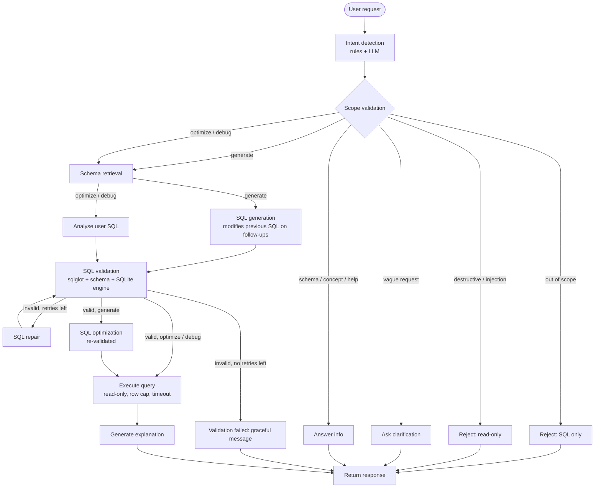

# SQL Query AI Agent

A task-focused AI agent that turns plain-English questions into **validated, read-only SQL**, explains the result,
and can also **optimise** or **debug** SQL you paste in. It refuses everything that is not about SQL or the
provided database. Built with **LangGraph + FastAPI + SQLite + sqlglot**.

- **Live app:** https://sql-query-ai-agent-agae.onrender.com/
- **Demo video:** `<ADD YOUR VIDEO LINK HERE>`

## What it does

| Requirement | How it is covered |
|---|---|
| Natural language → SQL | `sql_generation` node, schema-grounded prompt |
| Validation (tables, columns, joins, syntax, read-only) | `app/validator.py`, plain code (sqlglot + SQLite), no LLM |
| Explanation in plain English | `generate_explanation` node |
| Optimisation (readability, performance, indexes, unnecessary joins) | `sql_optimization` node (after generation) and `analyze_user_sql` (for pasted SQL) |
| Debugging (find issue, explain why, corrected query) | `analyze_user_sql` node in `debug` mode |
| Conversation context | LangGraph checkpointer (`MemorySaver`) keeps messages and the last SQL per session; follow-ups modify the previous query |
| Out-of-scope handling | Intent detection + scope routing; exact refusal message from the brief |
| Destructive requests | Refused by regex *before* any LLM call, and again by the SQL validator |
| UI | Chat, SQL panel (syntax highlighting, copy, download), explanation, results table (CSV download), query plan, history sidebar, loading steps, error toasts, dark mode, dialect selector, responsive layout |

**Bonus items included:** query execution against a sample DB, follow-ups, query-plan cost hints, syntax highlighting,
SQLite / PostgreSQL / MySQL output (via sqlglot), CSV export, prompt-injection protection, streaming progress (SSE),
Docker, unit and integration tests.

## Quick start (local)

```bas
```

### Get a free LLM key (any OpenAI-compatible provider works)
1. **Groq:** console.groq.com → API Keys → Create. Set `LLM_PROVIDER=groq`

Free-tier limits and model names change often. If you get a "model not found" or rate-limit error, set `LLM_MODEL`
to a model your provider currently lists. Each question uses about 3–4 LLM calls.

### Run the tests 
```bash
pytest -q
```
The agent tests use a scripted fake LLM, so they check the *graph logic and guardrails*, not model quality.

### Docker
```bash
docker build -t sql-agent . && docker run -p 7860:7860 --env-file .env sql-agent
```

## Deployment

**Render Free Spaces (Docker):** create a new Space → SDK **Docker** → upload this repo. Add `LLM_API_KEY` and
`LLM_PROVIDER` under *Settings → Variables and secrets*. The Dockerfile already listens on port 7860.
Add this header at the very top of the Space's README.md:
```
---
title: SQL Query AI agent
sdk: docker
app_port: 7860
---
```

**Render:** New → Web Service → connect the GitHub repo → Runtime **Docker** → add the env vars. Free instances
sleep when idle, so open the link once before a demo.

No login is needed to use the app. The database is created and seeded automatically on first start.

## Architecture

```
Browser (HTML/JS)  ──HTTP/SSE──▶  FastAPI (app/main.py)  ──▶  LangGraph agent (app/graph.py)
                                                               │      │
                                              OpenAI-compatible LLM   ├─ Validator (sqlglot + SQLite EXPLAIN)
                                              (Groq / Gemini / ...)   └─ SQLite, opened READ-ONLY (app/db.py)
```

### LangGraph workflow (`docs/workflow.mmd`)



### Node by node

| Node | Type | What it does |
|---|---|---|
| `intent_detection` | rules + LLM | First runs regex gates for destructive wording and prompt-injection phrases (no LLM involved). Otherwise the LLM classifies: `generate`, `optimize`, `debug`, `schema_info`, `sql_concept`, `help`, `destructive`, `out_of_scope`, and flags vague requests. |
| scope validation | conditional edge | Routes to a refusal, a clarification question, an info answer, or on to schema retrieval. |
| `schema_retrieval` | code | Reads tables, columns, foreign keys, plus the real values of low-cardinality columns (so "California" is spelled exactly as stored). |
| `sql_generation` | LLM | Writes a SQLite SELECT. Gets the chat history and the previous SQL, and is told to *modify* it for follow-ups. Returns `null` + a question if the schema cannot answer. |
| `analyze_user_sql` | LLM | For pasted SQL: *debug* (issue, why, corrected query) or *optimize* (cleaner query, index advice). |
| `sql_validation` | **code** | Single statement; SELECT only; tables exist; columns exist (aliases/CTEs resolved); joins checked against foreign keys; SQLite `EXPLAIN` accepts it. |
| `sql_repair` | LLM | If validation fails, the errors are fed back to the model. Maximum 2 retries, then a graceful failure message. Unverified SQL is never shown. |
| `sql_optimization` | LLM + code | Reviews a valid query for readability/performance/indexes. Its rewrite is only accepted if it also passes validation. |
| `execute_query` | code | Runs the query on a read-only connection with `PRAGMA query_only`, 100-row cap and 5 s timeout. Also collects SQLite's query plan. |
| `generate_explanation` | LLM | 2–4 plain-English sentences. |
| `return_response` | code | Builds the JSON reply (SQL in the chosen dialect, explanation, results, suggestions, warnings, plan) and stores the turn in memory. |

### Guardrails 

1. **Pre-LLM regex gates** refuse destructive and injection-style requests without calling the model.
2. **Scoped prompts**: every prompt restricts the model to the schema, SELECT only, and tells it that `<user_input>` text is data, not instructions.
3. **Code validator** never trusts the model: DML/DDL, `PRAGMA`, multi-statement SQL, unknown tables/columns are all rejected (see `tests/`).
4. **Read-only database connection** (`mode=ro` + `query_only`) as the last line of defence.
5. **Graceful failure**: after 2 failed repairs the user gets an explanation, never unchecked SQL.

## Prompts

All prompts are in [`app/prompts.py`](app/prompts.py): intent classification, generation, repair, analysis (debug/optimize),
post-generation optimisation, explanation and info answers. The shared ground rules are defined once (`_RULES`).

## Sample database

[`app/schema.sql`](app/schema.sql) defines `Employees`, `Customers`, `Products`, `Orders`, `OrderItems`.
[`app/seed.py`](app/seed.py) fills them with deterministic fake data (25 employees, 60 customers, 20 products, 200 orders).
To use a different schema, replace `schema.sql` (and `seed.py`), delete `app/data/company.db`, and restart. Nothing else is hard-coded.

## Try these

- Show all employees hired after January 2024.
- Show all customers. → *Only those from California.* → *Sort by name.*
- Top 5 customers by total spend, with their state.
- Fix this: `SELEC Name FROM Employes WHERE Salary > 50000`
- Optimise: `SELECT * FROM Customers c JOIN Orders o ON c.CustomerID = o.CustomerID WHERE c.State = 'Texas'`
- Delete all orders → refused. · Who won the FIFA World Cup? → refused.

## Assumptions and limitations

- The brief says a schema "will be provided" but none was attached, so I created the sample schema above. It is swappable (see *Sample database*).
- SQL is generated and executed on **SQLite**. PostgreSQL / MySQL output is a sqlglot translation of the validated SQLite query, shown but not executed.
- Pasted SQL is assumed to be SQLite-flavoured.
- Conversation memory is in-process (`MemorySaver`), so it resets when the server restarts. The browser keeps chat transcripts in `localStorage`. For production, swap in a persistent LangGraph checkpointer.
- The foreign-key join check produces a **warning**, not an error, because joins on non-FK columns can be legitimate.
- No authentication or rate limiting. Add both before exposing this beyond a demo.
- LLM output quality depends on the free model you choose. Smaller models may need the repair loop more often.

## Project layout

```
app/        main.py (API) · graph.py (LangGraph) · validator.py · db.py · llm.py · prompts.py · schema.sql · seed.py
frontend/   index.html (single-page UI, no build step)
tests/      validator + agent + API tests
docs/       workflow.mmd
```
